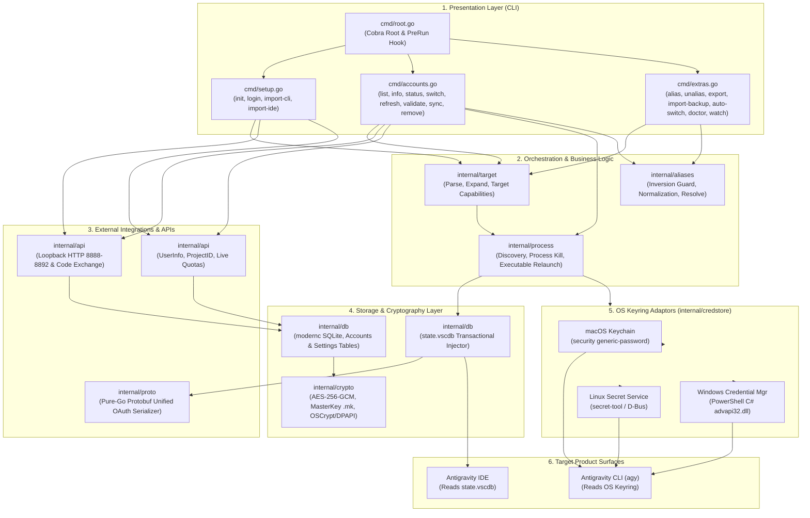
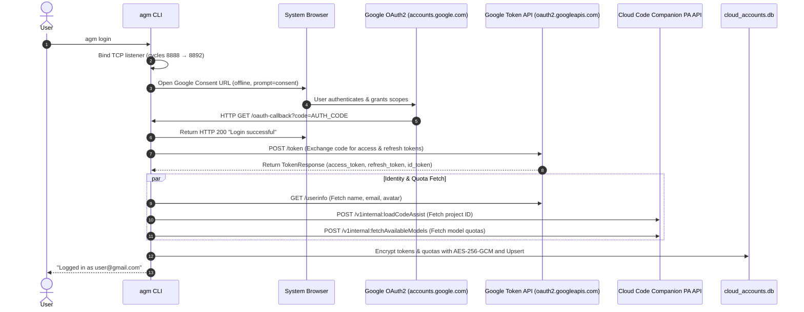
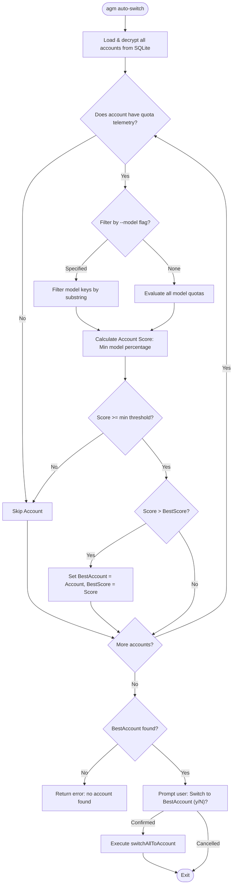
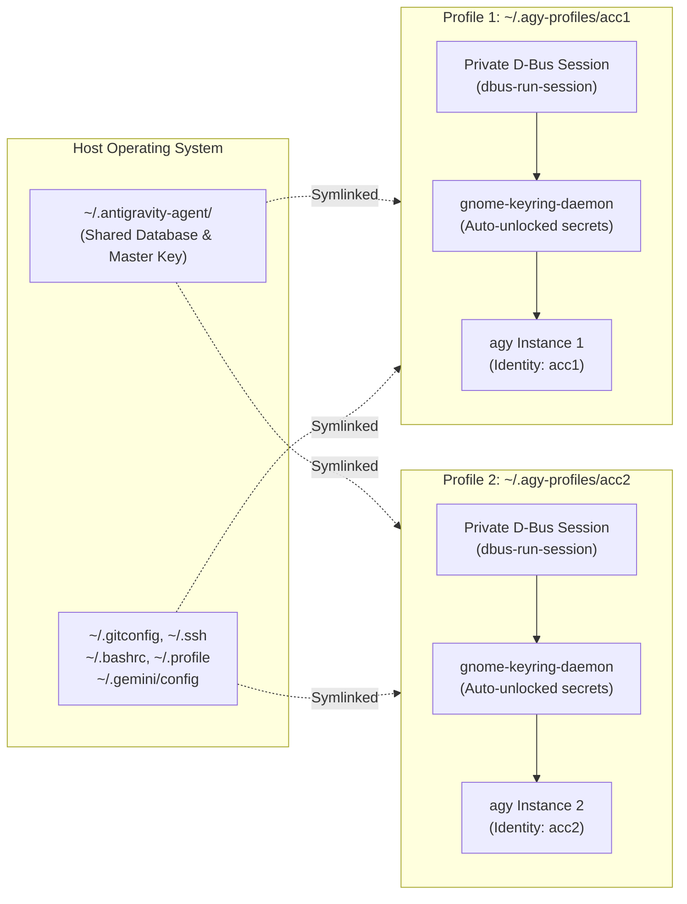

# Architecture Specification — agm (Antigravity Account Manager)

This document provides a comprehensive technical breakdown of the architecture, subsystems, data flows, security mechanisms, and platform abstractions in `agm`.

---

## 1. Architectural Principles & System Goals

`agm` is designed around five foundational tenets:

1. **Zero External Runtime Dependencies (Pure Go)**: Built using `modernc.org/sqlite` instead of `mattn/go-sqlite3`. It requires no CGO, no C compiler, and no dynamic shared libraries. The resulting binary is completely static and portable.
2. **Client-Side Zero-Trust Encryption**: All sensitive OAuth credentials (refresh tokens, access tokens, project IDs) and quota telemetry are encrypted at rest using **AES-256-GCM** before touching SQLite.
3. **Decoupled Surface Injection**: Abstract target definitions (`agy` CLI vs. `ide` Antigravity IDE) isolate platform-specific credential storage from product-specific state databases.
4. **Resilient Process & State Lifecycle**: Modifying GUI state databases (`state.vscdb`) executes an atomic sequence: automated database backup (`state.vscdb.backup`), graceful process termination, transactional SQLite insertion, and process restart.
5. **Concurrent Multi-Tenant Profile Isolation**: Solves Antigravity CLI's default single-keyring limitation by supporting virtualized D-Bus keyring environments for parallel execution.

---

## 2. High-Level System Architecture

The following diagram illustrates the structural layers of `agm` and its external integration points:



---

## 3. Subsystem Breakdown

### 3.1. Presentation Layer (`cmd/`)

The CLI commands are constructed using [spf13/cobra](https://github.com/spf13/cobra):

- **Automatic Store Guarantee (`PersistentPreRunE`)**: [`cmd/root.go`](file:///home/khoa/work/code/App/agm-main/cmd/root.go) intercepts every execution (except `help` and `--help`) and invokes [`db.EnsureStore()`](file:///home/khoa/work/code/App/agm-main/internal/db/db.go#L63). This lazily provisions `~/.antigravity-agent/`, the AES master key `.mk`, and SQLite tables on the first invocation of *any* command.
- **Dynamic Shell Completion**: [`cmd/accounts.go`](file:///home/khoa/work/code/App/agm-main/cmd/accounts.go#L482) implements `completeAccountsAndAliases`, dynamically loading registered accounts from the database and alias names from `aliases.json` to power shell tab-completion across commands.
- **Diagnostics Engine**: [`cmd/extras.go`](file:///home/khoa/work/code/App/agm-main/cmd/extras.go#L243) implements `agm doctor`, performing an 8-point system audit (data directory, SQLite accessibility, master key decryptability, IDE database path, `agy` CLI binary, OS keyring status, IDE executable, and account integrity).

---

### 3.2. Authentication & External API Layer (`internal/api/`)

Handles all communication with Google OAuth endpoints and Cloud Code companion microservices.



#### API Endpoints Used:
| Endpoint | Method | Purpose |
|---|---|---|
| `https://accounts.google.com/o/oauth2/v2/auth` | GET | Interactive browser consent flow requesting offline access. |
| `https://oauth2.googleapis.com/token` | POST | Authorization code exchange and token refresh (`grant_type=refresh_token`). |
| `https://www.googleapis.com/oauth2/v2/userinfo` | GET | Profile identity retrieval (`email`, `name`, `picture`). |
| `https://cloudcode-pa.googleapis.com/v1internal:loadCodeAssist` | POST | Retrieves the user's active Google Cloud AI companion project ID. |
| `https://cloudcode-pa.googleapis.com/v1internal:fetchAvailableModels` | POST | Live quota telemetry (remaining fraction and reset timestamp per model). |

---

### 3.3. Target Routing & Process Lifecycle (`internal/target/` & `internal/process/`)

The target subsystem decouples how credentials are applied based on product surface:

| Target | Identifier | Storage Mechanism | Process Management |
|---|---|---|---|
| **Antigravity CLI** | `agy` (or `cli`) | OS Credential Store (`gemini:antigravity`) | No process management. CLI reads credential store on each invocation. |
| **Antigravity IDE** | `ide` | Direct SQLite injection into `state.vscdb` | Terminate running GUI processes, inject into database, relaunch application. |
| **All Surfaces** | `all` (default) | Executes `agy` first, followed by `ide` | Inherits individual target behaviors. |

#### Process Switching Workflow:

```mermaid
sequenceDiagram
    autonumber
    participant Cmd as agm switch
    participant Process as internal/process
    participant Target as internal/target
    participant Keyring as internal/credstore
    participant SQLite as internal/db (state.vscdb)
    participant IDE as Antigravity IDE Executable

    Cmd->>Cmd: Resolve alias & match email (dot-insensitive)
    Cmd->>Cmd: Check token expiry (refresh if expired)
    Cmd->>Target: Expand target (e.g. All -> [Agy, IDE])
    
    rect rgb(20, 30, 45)
        note over Cmd,Keyring: Stage 1: CLI Target
        Cmd->>Keyring: WriteToken(payload) to OS Keyring (gemini:antigravity)
        Keyring-->>Cmd: Success
    end
    
    rect rgb(30, 20, 40)
        note over Cmd,IDE: Stage 2: IDE Target
        Cmd->>Process: SwitchFlow(Target=IDE)
        Process->>Process: KillForTarget("Antigravity IDE")
        Process->>SQLite: copyFile(state.vscdb, state.vscdb.backup)
        Process->>SQLite: InjectTokenIntoStateDB()
        SQLite-->>Process: Committed
        Process->>IDE: StartForTarget(FindExecutable("ide"))
        Process-->>Cmd: Success
    end

    Cmd->>Cmd: SetActiveForTarget() & SetActive()
```



---

### 3.4. Protobuf Wire-Format Serialization (`internal/proto/`)

Antigravity IDE stores OAuth session state inside SQLite column `antigravityUnifiedStateSync.oauthToken` as a base64-encoded, nested Protocol Buffer.

Rather than introducing heavyweight external code generation dependencies (`protoc`, `protobuf-go`), `agm` implements a dedicated, zero-alloc wire-format encoder and decoder in [`internal/proto/proto.go`](file:///home/khoa/work/code/App/agm-main/internal/proto/proto.go):

```
Unified Topic Entry (Length-Delimited Field 1)
└── Row Entry (Field 1: sentinelKey "oauthTokenInfoSentinelKey")
    └── Row Value (Length-Delimited Field 2: Base64 payload)
        └── OAuthInfo Message:
            ├── Field 1 (string): Access Token
            ├── Field 2 (string): Token Type ("Bearer")
            ├── Field 3 (string): Refresh Token
            └── Field 4 (Length-Delimited Timestamp):
                ├── Field 1 (varint): Expiry Seconds
                └── Field 2 (varint): Nanos (0)
```

The decoder [`ExtractOAuthFromUnified`](file:///home/khoa/work/code/App/agm-main/internal/proto/proto.go#L69) performs inverse varint and length-delimited boundary traversal, enabling `agm import-ide` to recover active sessions directly from IDE databases.

---

### 3.5. Platform Credential Store Implementations (`internal/credstore/`)

Antigravity CLI (`agy`) expects session credentials in the native OS secret store under the identifier `gemini:antigravity`.

| Operating System | Tooling / Backend | Storage Mechanism | Implementation Detail |
|---|---|---|---|
| **macOS** | `/usr/bin/security` | macOS Keychain | Writes generic password with `-a antigravity -s gemini`, prefixed with `go-keyring-base64:` and base64-encoded JSON payload. Uses `-U` (update) and `-A` (allow all applications). |
| **Linux** | `secret-tool` / libsecret | Freedesktop Secret Service (GNOME Keyring / KWallet) | Stores attribute pair `service="gemini"`, `username="antigravity"`. Payload passed via stdin to avoid process argument snooping. |
| **Windows** | PowerShell inline C# | Windows Credential Manager (`advapi32.dll`) | Calls `CredWrite` / `CredRead` via P/Invoke with `CRED_PERSIST_LOCAL_MACHINE (2)` and TargetName `gemini:antigravity`. |

---

### 3.6. Cryptographic Engine & Storage (`internal/crypto/` & `internal/db/`)

#### 1. Key Derivation & Hierarchy
- The master key is a cryptographically secure 256-bit random key (`crypto/rand`).
- Stored as a 64-character hexadecimal string in `~/.antigravity-agent/.mk` with POSIX file permissions `0600`.
- **Legacy Fallback**: If `.mk` contains Chromium OSCrypt / DPAPI ciphertext (from earlier Electron manager installations), `agm` transparently decrypts the payload via `CryptUnprotectData` (Windows) or Keychain (macOS).

#### 2. Authenticated Encryption Envelope
Every encrypted database field uses **AES-256 in Galois/Counter Mode (GCM)**:

$$\text{Ciphertext Format} = \texttt{"agm\_enc\_v1:"} \parallel \text{hex}(IV) \parallel \texttt{":"} \parallel \text{hex}(Tag) \parallel \texttt{":"} \parallel \text{hex}(Ciphertext)$$

- **IV / Nonce**: 16 cryptographically random bytes generated per encryption.
- **Tag**: 16-byte authentication tag ensuring integrity and authenticity (prevents tampering).

#### 3. Database Schema (`cloud_accounts.db`)

```sql
CREATE TABLE IF NOT EXISTS accounts (
    id TEXT PRIMARY KEY,
    provider TEXT NOT NULL,
    email TEXT NOT NULL,
    name TEXT,
    avatar_url TEXT,
    token_json TEXT NOT NULL,          -- AES-256-GCM encrypted Token struct
    quota_json TEXT,                   -- AES-256-GCM encrypted Quota struct
    device_profile_json TEXT,
    device_history_json TEXT,
    created_at INTEGER NOT NULL,
    last_used INTEGER NOT NULL,
    status TEXT DEFAULT 'active',
    status_reason TEXT,
    is_active INTEGER DEFAULT 0,
    proxy_url TEXT
);
CREATE INDEX IF NOT EXISTS idx_accounts_email ON accounts(email);

CREATE TABLE IF NOT EXISTS settings (
    key TEXT PRIMARY KEY,
    value TEXT NOT NULL                -- JSON-quoted values (e.g. active_cloud_account.agy)
);
```

---

## 4. Intelligent Auto-Switching Architecture

The `agm auto-switch` command automates quota maximization across accounts:



---

## 5. Concurrent Session Isolation Architecture

To overcome the single OS keyring constraint (`gemini:antigravity`), `agm` implements a built-in containerized session runner (`cmd/run.go` and argument rewriting in `cmd/root.go`):



1. **Direct Invocation Rewriting (`cmd/root.go`)**: When a command like `agm acc1 [args...]` is executed, `Execute()` checks if the first argument is a recognized subcommand. If not, but it matches an alias or account email, `os.Args` is dynamically rewritten to `agm run acc1 [args...]`.
2. **Virtualized D-Bus Session (`cmd/run.go`)**: Wrapped in `dbus-run-session` with a quiet daemon wrapper, isolating the IPC socket endpoint and avoiding stderr noise.
3. **Headless Auto-Unlocked Keyring**: An ephemeral `gnome-keyring-daemon` is launched with `--login --components=secrets` and automatically unlocked with an empty password via pipe.
4. **Per-Profile State Sandbox**: An isolated profile is created at `~/.agy-profiles/<name>` with its own `.runtime`, `.local/share/keyrings`, and `.gemini/antigravity-cli`.
5. **Seamless Developer Environment**: Dotfiles (`~/.gitconfig`, `~/.ssh`, `~/.bashrc`, `~/.profile`), global skill customizations (`~/.gemini/config`), and CLI binaries are symlinked so the agent operates with all user tools and configuration intact.
6. **Master Store Linked**: Symlinks `~/.antigravity-agent` into the isolated profile so token refreshes and quota records stay in sync across all instances.

---

## 6. Resilience & Failure Handling

| Failure Scenario | Recovery Mechanism |
|---|---|
| **Port Conflict during OAuth** | Cycles sequentially through `8888`, `8889`, `8890`, `8891`, and `8892` before surfacing an error. |
| **Expired Access Token** | Verified prior to any target switch. If expired, automatically refreshed via `RefreshAccessToken` and persisted before proceeding. |
| **Corrupted Target Database Injection** | Automatically creates `state.vscdb.backup` prior to performing SQLite upsert transactions on Antigravity IDE state. |
| **Inverted Alias Input** | Detects when a user runs `agm alias email alias` instead of `agm alias alias email` and automatically swaps the parameters while purging reverse lookup traps. |
| **Dot-Insensitive Email Lookups** | Sanitizes periods in email addresses so `johnsmith` matches `john.smith@gmail.com`. |
| **Headless Keyring Unavailability** | Emits actionable diagnostic error messages directing the user to wrap commands with D-Bus or install `libsecret-tools`. |

---

## 7. Security Model & Boundaries

1. **OAuth Scopes Minimization**: Restricts requested Google scopes strictly to Cloud Platform, User Info (`email`, `profile`), and Cloud AI Companion APIs (`cclog`, `experimentsandconfigs`, `aicode`).
2. **Restricted File System Access**:
   - Master Key file (`.mk`) is strictly set to POSIX mode `0600` (read/write only by file owner).
   - Local directory `~/.antigravity-agent` is initialized with mode `0700`.
   - Backup export files (`agm export`) default to mode `0600`.
3. **Export Protection**: The `agm export` command outputs encrypted `token_json` and `quota_json` fields. Data cannot be decrypted without physical access to the machine's `.mk` file.
4. **Token Sanitization in Diagnostics**: `agm doctor`, `agm status`, and `agm list` never print raw token credentials to stdout or stderr.
